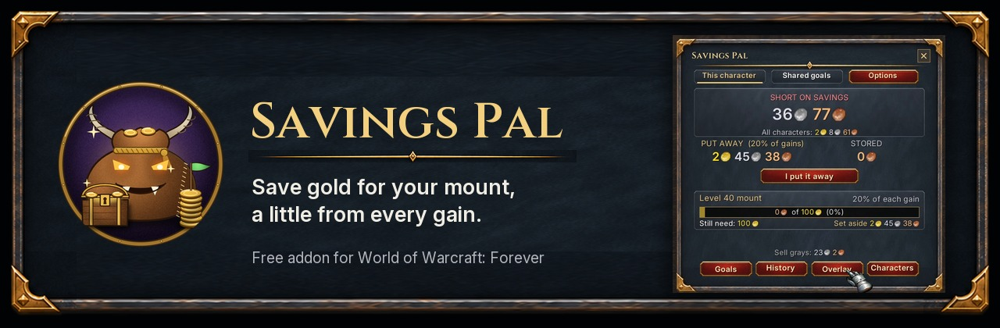
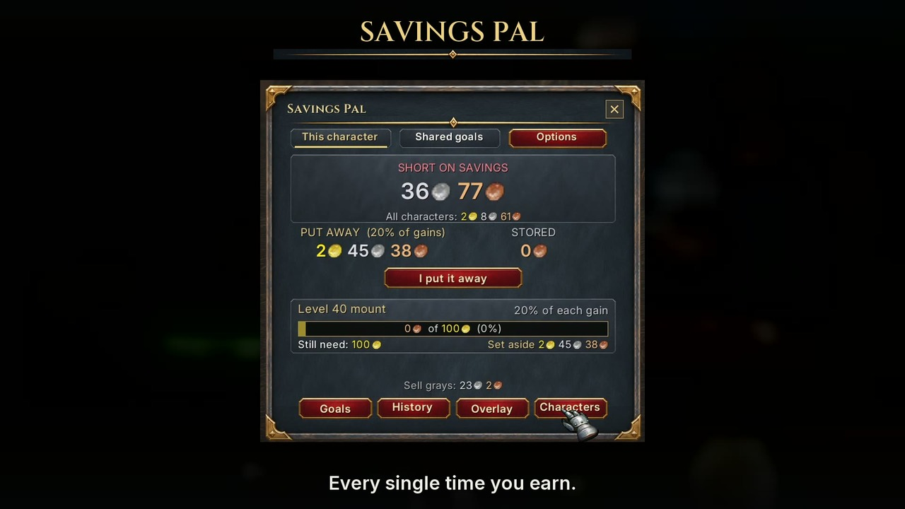
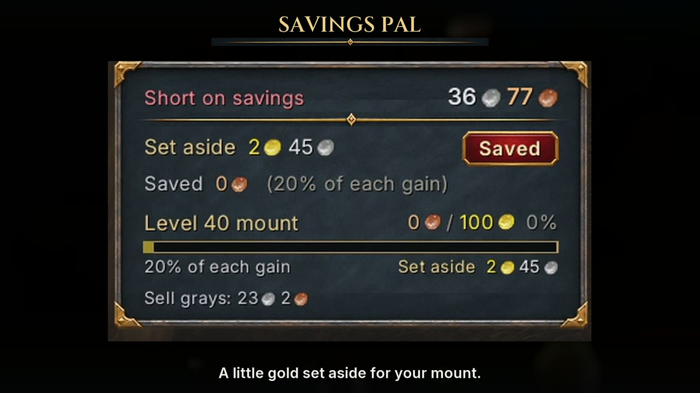
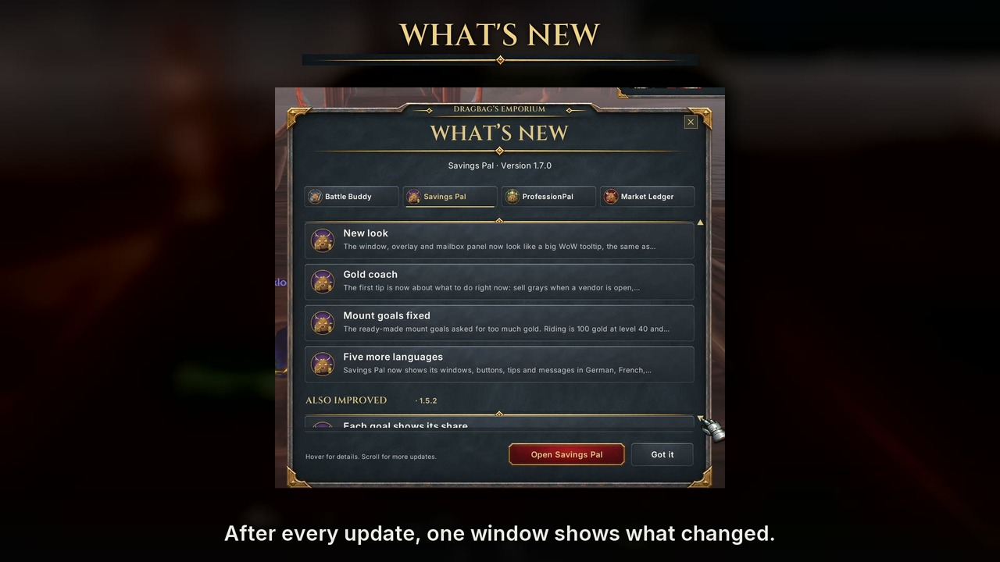

# Savings Pal

**[Get it on CurseForge](https://www.curseforge.com/wow/addons/drags-hedge-fund)** · [Download the zip](https://github.com/Yungslaya/DragsHedgeFund/releases/latest/download/DragsHedgeFund.zip) · [All changes](CHANGELOG.md)

**Stop spending the gold you meant to save**

Savings Pal sets aside a cut of every gold gain for the things you are saving for, and reminds you to put it away.

**[Watch the video on YouTube](https://youtu.be/2W8BDpfz9jg)**

## At a glance

- Set a goal, like your first mount
- Pick what percent of each gain to save
- See what you can spend and what you owe your goals
- At the mailbox, it fills in the mail to your bank alt. You press Send
- Several goals at once, shared across your characters
- A gold coach tip for right now: sell grays, fill a bag slot, train only what you use
- It never moves gold by itself
- Type **/savings** to start

## How it works

1. Type **/savings** and add a goal and how much it costs. Ready-made mount goals are there: 100 gold for level 40 riding and 1,000 gold for level 60 riding. Your first mount at each step is free.
2. Pick what percentage of your earnings goes to it.
3. As you loot and sell, the addon adds up what you should put away.
4. Mail it to a bank alt or put it in the bank, then click **I put it away**.

## A small overlay keeps count

It shows what is set aside, how far each goal is, and a tip for right now. Click **Saved** when you have put the gold away.

## New: one look, and a What's new window

Every window now has the same stone frame, gold corners and clean text as our other addons. After an update, one window shows what changed, with a tab for each of our addons you have. Type **/savings news** to see it again.

## Languages

English, German, French, Spanish, Russian and Simplified Chinese. The addon switches by itself to match your game.

Only English has been tested in the game. The other languages are new and may have mistakes or parts still in English. If something looks wrong in your language, please post it in the comments.

## Commands

- **/savings** (or the old /gg) opens the window.
- **/savings news** shows what changed.
- **/gg coach** turns the coach tips on or off.
- **/gg starter** shows the simple starting setup, and **/gg restore** puts your old settings back.

Savings Pal used to be called Drags Hedge Fund. Same addon, same settings.

## More from Dragbag's Emporium

Four free addons with one shared look. Use one, or all four.

- **[Battle Buddy](https://www.curseforge.com/wow/addons/dbagsalerts)**: your next spell, timers and reminders, for all nine classes.
- **[ProfessionPal](https://www.curseforge.com/wow/addons/professionpal)**: one clear next step for every profession, and where to farm it.
- **[Market Ledger](https://www.curseforge.com/wow/addons/market-ledger)**: what to sell, vendor and keep, right at the Auction House.

## What's new

- **1.7.1:** a long goal name no longer runs under the gold numbers on the overlay. Type `/reload` after updating.
- **1.7.0:** a new look for the window, overlay and mailbox panel, and a What's new window after updates. Fully restart WoW after updating (new files were added).
- **1.5.2:** each goal shows its percent and how much is set aside for it, and a new look that matches ProfessionPal. Fully restart WoW after updating (a new file was added).
- **1.5.1:** Update messages only come from real CurseForge releases. Type `/reload` after updating.
- **1.5.0:** Drags Hedge Fund is now called **Savings Pal**. Same addon, same goals and saved gold. New command `/savings`, and a message when a newer version is out. Fully restart WoW after updating (a new file was added).

[All changes](CHANGELOG.md)

## Install

1. Easiest: install **Savings Pal** from [CurseForge](https://www.curseforge.com/wow/addons/drags-hedge-fund) with the CurseForge app.
2. WowUp: Get Addons, Install from URL, and paste `https://github.com/Yungslaya/DragsHedgeFund`.
3. By hand: [download the zip](https://github.com/Yungslaya/DragsHedgeFund/releases/latest/download/DragsHedgeFund.zip), unzip it, and put the `DragsHedgeFund` folder in `World of Warcraft\_forever_\Interface\AddOns`.

Fully restart WoW after installing.

## More details

Open the full guide

### Starter setup (starter setup)

Start with `/gg` and add your own goal and savings percentage. No goals or saved gold are invented. The locked overlay appears after you add a goal and hides in combat. Overlay tips and sounds start off. Shared goals and other-character tools are available when you choose them.

Open Options to enable extras. `/gg starter` applies starter display options; `/gg restore` restores your previous choices. These presets never change goals, percentages, stored savings, pending amounts, transaction history or personal/shared scope. Existing users keep their choices.

### Start here

1. Fully restart WoW after installing this update. The new account-wide saved data needs a restart.
2. Log into each character once with the addon enabled.
3. Open /gg and click **Characters** to see your total and each character's balance.
4. Each character you are playing updates live. Alts show their last recorded balance and the date.
5. Only bag gold is counted. Bank balances, unclaimed mail, auctions and other currencies are not added.

### Personal and shared goals

- **This character** saves to that character's personal goals.
- **Shared goals** saves to the common goals for this realm.
- The current character remembers which mode you select. Enabling shared goals makes them the default for new alts.
- Click **Goals**, then **Share** beside an existing personal goal to move its target, stored amount and pending amount into shared goals.
- You can also select **Shared goals** and add a new goal.
- Each goal has its own percentage. The percentages in the selected mode total no more than 100%. Set 0% to pause a goal.
- Shared progress is visible on every character using Shared goals. Personal goals are preserved in the other mode.
- Other realms appear in the total, but have separate shared goals because their gold may not be transferable.

### Existing gold is optional

By default, only future gold increases get a cut. Logging into an alt does not count its existing gold as earnings.

To reserve a percentage of existing gold:
1. Select **Shared goals** and set their percentages.
2. Open **Characters**, then click **Use current gold for shared goals**.
3. Read the preview and click **Reserve it**.

Example: Alice has 60g and Bob has 40g. One shared goal at 20% reserves 12g from Alice and 8g from Bob.
The same existing balance is not reserved again for that goal. A new alt can contribute once it has been recorded.
Existing pending contributions and recorded stored savings are excluded from the available pool.
Alt balances are snapshots. Refresh them by logging into each character before making a pooled contribution.

Reserving money only increases **Put away**. It does not mark the money as stored or move it.

### Put the money away

Each character owes only its own contributions. Mail or bank that gold, then click **I put it away**.
The mailbox helper fills the recipient, amount and goal note. You press Blizzard's Send button.
On a successful send, only that character's contribution is confirmed.

**Stored** is confirmed savings. **Can spend (here)** is bag gold minus pending contributions on this character.
Personal contributions remain protected when you switch to Shared goals.

The main window shows **All characters** as well. This is remembered bag gold, not stored progress.

### Moving your own gold between alts

Receiving your own gold normally looks like a new gain to the money API.
Immediately before collecting an own transfer, open **Characters** and click **Skip next own transfer**.
The next money increase is ignored, even if it is loot instead. Normal tracking then resumes.
The skip expires after 30 minutes if unused. This does not transfer money for you.

### History and overlay

History shows recorded money increases, cuts and deposits. Partial deposits show what is still owed.
Unpaid entries are retained until settled. The newest 300 settled records are retained.
Blizzard may combine several balance changes into one money event.

The overlay shows this character's spendable amount, contribution due and goal progress.
Drag it to move; right-click opens the full window.

### Commands

- /gg, /hedge, /dhf: open or close
- /gg characters: character gold list
- /gg shared: save to shared goals
- /gg personal: save to personal goals
- /gg transfer: ignore the next incoming own transfer
- /gg goal: manage goals
- /gg mini: overlay on or off
- /gg lock: lock the overlay
- /gg scale 1.2: overlay size
- /gg pct 20: set each goal in the selected mode to 20%, capped to a combined 100%
- /gg saved: confirm this character's pending contribution in the selected mode
- /gg add 10 2 or /gg set 50 1: fix a goal's stored amount
- /gg reset: clear goals in the selected mode; Shared mode clears shared goals for this realm

### Notes

Display only. It never buys, sells, trades or sends mail for you.
The preset riding and mount amounts are estimates from earlier Wowhead Forever research.

